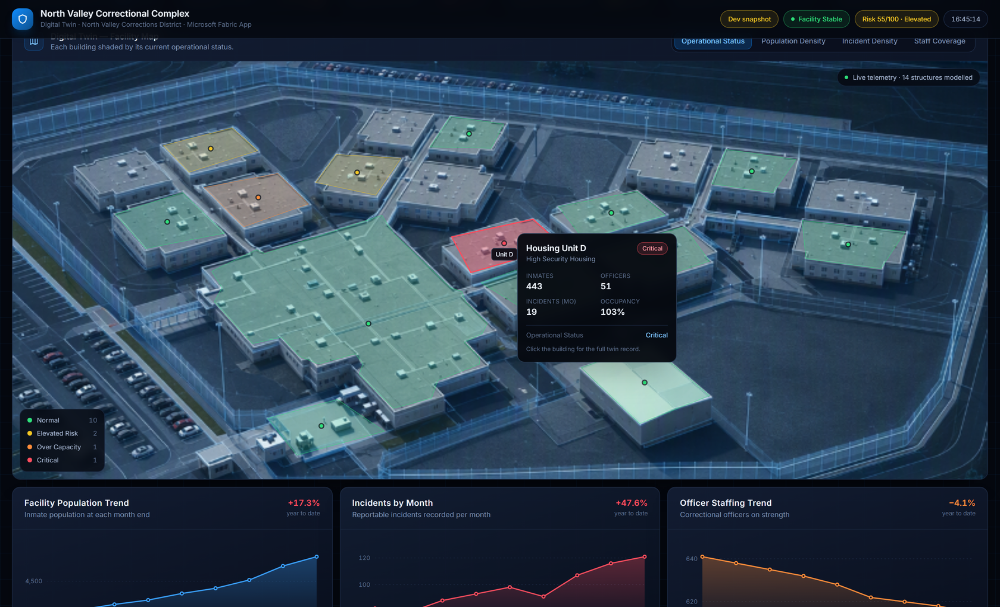
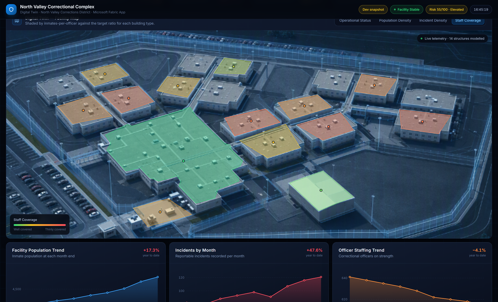
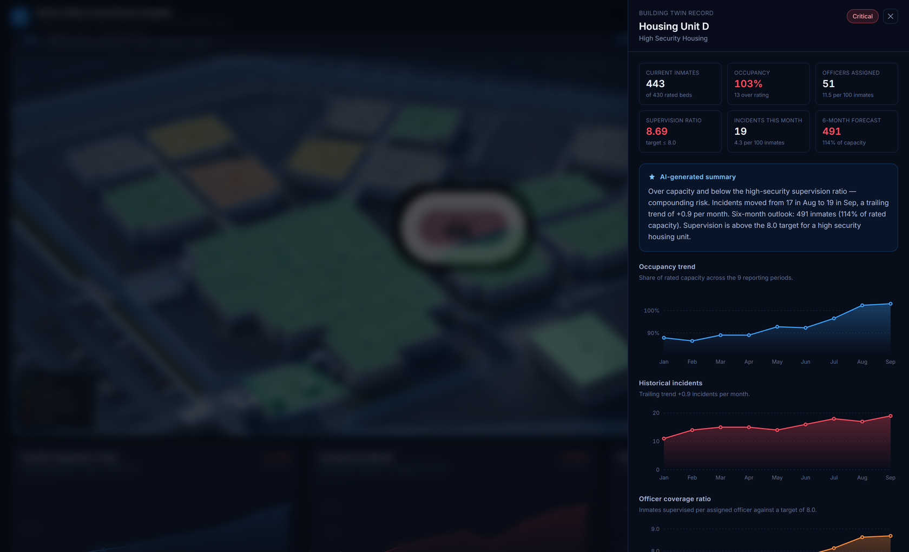
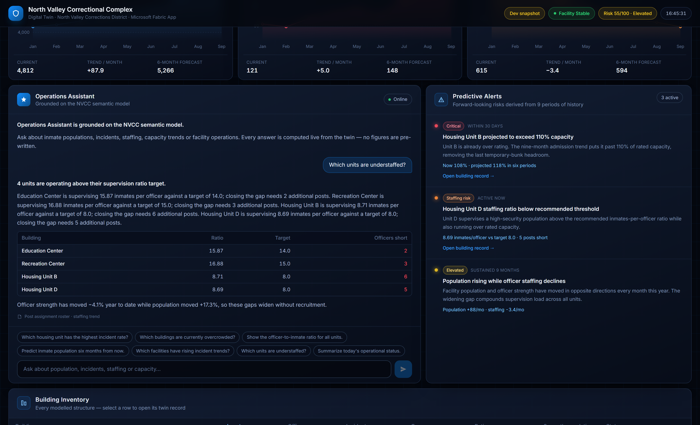
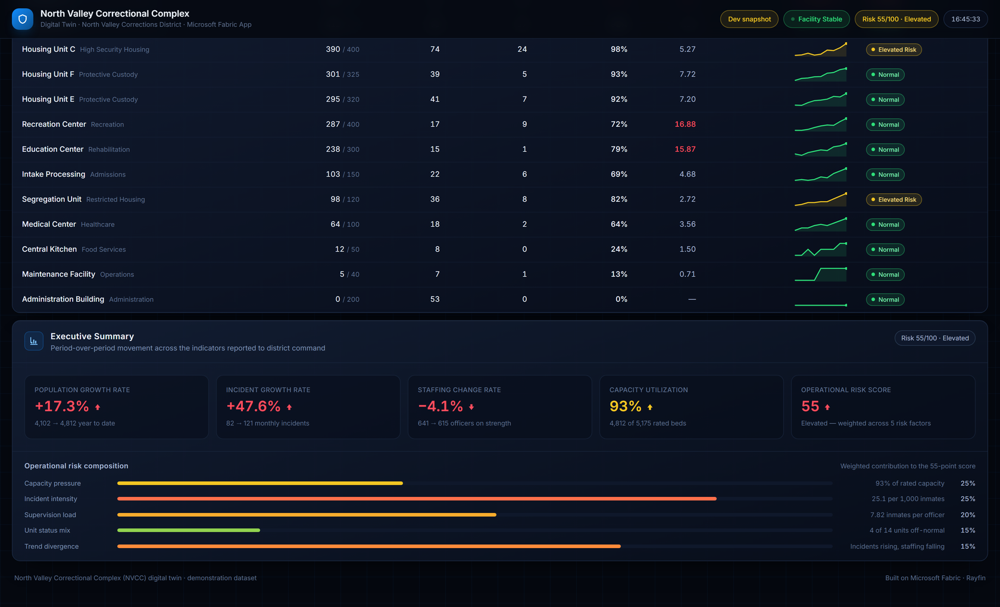

# Smart Corrections Digital Twin

A Microsoft Fabric App that presents a large correctional facility as an interactive
operations centre: an aerial facility map with per-building hotspots, capacity and
staffing telemetry, nine periods of history, predictive alerts, an executive risk
summary, and a grounded natural-language Operations Assistant.

All operational figures are queried from a Power BI **semantic model** that ships
with this template. Sign-in is Fabric SSO (Entra ID) only.


> **Synthetic data.** North Valley Correctional Complex is fictional and every
> figure is invented for demonstration. No real facility or offender data is used.

---

## What it demonstrates

| Capability | How |
|---|---|
| Spatial digital twin | SVG hotspot overlay traced to an aerial photograph, 14 buildings |
| Operational KPIs | Population, officers, incidents, occupancy, overcrowding, status |
| Historical trends | Population, incidents and staffing across nine reporting periods |
| Heat maps | Four shading modes over the same footprints |
| Predictive alerts | Forward-looking capacity, staffing and divergence risks |
| Grounded NL assistant | Intent routing over the twin — no pre-written answers |
| Executive reporting | Growth rates plus a decomposed operational risk score |

### Facility map

Hovering a building shows its name, type, inmate count, officers assigned, incidents
this month, occupancy percentage and operational status. Clicking opens the twin
record: occupancy trend, historical incidents, officer coverage ratio, a six-period
capacity forecast and an AI-generated summary.



`Operational Status` colours each building green (Normal), yellow (Elevated Risk),
orange (Over Capacity) or red (Critical). Three heat-map modes re-shade the same
footprints by **Population Density**, **Incident Density** and **Staff Coverage**.



### Building detail



### Operations Assistant

Answers are assembled from the model at call time, so they cannot drift from what
the dashboard renders. Unrecognised questions fall back rather than inventing
figures.



### Executive summary



---

## Prerequisites

- A Fabric workspace on an **active** capacity (F2 or higher, or a trial)
- `rayfin` CLI — `npx rayfin` works without a global install
- Node 20+
- Permission to create a Fabric App and a semantic model in the target workspace

---

## Deploy

### 1. Deploy the semantic model

The model in `semantic-model/` is a PBIP/TMDL folder. Its tables are **inline M
literals**, so there is no data source to bind, no gateway, and refresh never
prompts for credentials.

Publish it with whichever route you prefer:

- **Fabric portal** — *Workspace → New → Semantic model → import the folder*
- **fabric-cli** — `fab import <workspace>/NorthValleyCorrectionsTwin.SemanticModel -i semantic-model`
- **Power BI Desktop** — open the folder as a PBIP project, then publish

Note the resulting **semantic model ID** (it is in the item's URL).

### 2. Point the app at your model

Edit `fabric.yaml` and replace both placeholders:

```yaml
correctionsTwin:
  workspaceId: <your-workspace-id>
  itemId: <your-semantic-model-id>
```

Then regenerate the typed binding so `src/fabric.generated.ts` matches:

```bash
npx fabric-app-data
```

### 3. Deploy the app

```bash
npm install
npx rayfin login
npx rayfin up --workspace "<your-workspace-name>"
npx rayfin up status
```

> Pass `--workspace` explicitly. Without it the CLI provisions a brand-new
> workspace instead of reusing yours.

`rayfin up` appends the generated hosting URL to `allowedRedirectUris` in
`rayfin/rayfin.yml` automatically.

### 4. Open it from the Fabric portal

Static assets are set to `protected`, and the semantic-model queries travel over
the Fabric embed proxy — both require the Fabric host. Opening the hosting URL
directly returns 401 by design.

Viewers need **read access to the semantic model**, not just the app; the query
runs as the signed-in user.

---

## Local development

```bash
npm run dev
```

The embed proxy has no Fabric host outside the portal, so the app falls back to
`src/lib/twin-fixture.ts` and the header shows a **Dev snapshot** badge. That
fallback sits behind `import.meta.env.DEV` and is statically eliminated from
production builds — a deployed app can only render figures queried from the model.

---

## The semantic model

### Star schema

```text
Building (dimension, 14 rows)            Month (dimension, 9 rows)
  Building ID (hidden)                     Month Key (hidden)
  Building, Short Name, Building Type      Month, Month Abbreviation
  Operational Status, Operational Note     Month Start Date
  Capacity (hidden), Is Residential

Building Metrics (fact, 126 rows)        Facility Metrics (fact, 9 rows)
  Building ID → Building                   Month Key → Month
  Month Key   → Month                      Population / Officer / Incident Count
  Inmate / Officer / Incident Count        Design Capacity Count
```

### Semi-additive measures

Population and officer strength are **stocks** (a balance at a point in time);
incidents are a **flow** (accumulated over a period). Summing a stock across nine
months would be meaningless, so stock measures resolve to the latest month in
filter context:

```dax
Inmates =
VAR LastMonth = MAX ( 'Month'[Month Key] )
RETURN
    CALCULATE (
        SUM ( 'Building Metrics'[Inmate Count] ),
        REMOVEFILTERS ( 'Month' ),
        'Month'[Month Key] = LastMonth
    )
```

The same measure is then correct at every grain: filtered to one month it gives
that month, unfiltered it gives the current period rather than a nonsense total.

### Two measure families

- **Building-level** (`Inmates`, `Officers`, `Occupancy Rate`) aggregate the
  modelled buildings.
- **Facility-level** (`Facility Population`, `Facility Occupancy Rate`) come from
  the corrections management roll-up, which spans the whole complex including
  structures the twin does not model individually.

That is why headline population (4,812) exceeds the sum of the buildings (3,188).
The KPI cards show the instrumented subtotal underneath so the two never look
contradictory.

### Regenerating the model

`semantic-model/` is generated from the app's own fixture, so the deployed model
and the dev snapshot cannot drift apart:

```bash
npx tsx scripts/generate-semantic-model.ts
```

Edit the data in `src/lib/twin-fixture.ts`, re-run, and redeploy.

---

## Adapting it to your scenario

| To change | Edit |
|---|---|
| Facility photo | Replace `src/assets/facility-aerial.png` |
| Building footprints | `src/data/geometry.ts` — percent-of-image polygons |
| Buildings, history, alerts | `src/lib/twin-fixture.ts`, then regenerate the model |
| Supervision ratio policy | `SUPERVISION_RATIO_TARGET` in `src/data/twin.ts` |
| Risk score weights | `buildTwin()` in `src/lib/metrics.ts` |
| Assistant questions | `INTENTS` in `src/lib/copilot.ts` |

### Building hotspots

Each footprint is expressed in **percent of the aerial image's width and height**,
keyed by building id and joined onto the model rows at load time. The map renders
the image in a square layer and overlays an SVG with `viewBox="0 0 100 100"`, so a
coordinate maps 1:1 onto the photograph at any size.

The shipped polygons were fitted to the real roof boundaries: segmented by
brightness, split with a marker-controlled watershed (one marker per building, so
adjacent blocks separate along their true edges), then reduced to the four hull
vertices enclosing the largest area. A *quadrilateral* rather than a bounding
rectangle matters — these roofs are photographed obliquely and project to
parallelograms, and a rectangle encloses 20–60% more ground than roof.

---

## Architecture

```text
src/queries/twin.ts        Three DAX queries + the columns each projection returns
src/lib/fabric-client.ts   FabricClient over the embed proxy; detects portal embedding
src/lib/twin-loader.ts     Maps query results → TwinData (resolved by column name)
src/data/twin.ts           Data contract, facility metadata, policy thresholds
src/data/geometry.ts       Building footprints (presentation geometry, not model data)
src/lib/metrics.ts         buildTwin(data) → all derived analytics, a pure function
src/lib/copilot.ts         Intent routing for the Operations Assistant
src/hooks/TwinContext.tsx  Fetches once, exposes the derived twin to components
```

Results arrive row-major, so the loader resolves every value **by column name**. A
reordered `SUMMARIZECOLUMNS` fails loudly instead of silently shifting values.

Only base facts come from the model. Regressions, six-period forecasts, the
supervision-ratio thresholds and the composite risk score are derived client-side
in `metrics.ts`, a pure function of the fetched data.

### Services

| Service | Enabled | Why |
|---|---|---|
| `auth` (Fabric SSO) | yes | Gates access to the dashboard |
| `auth` (password) | no | Local-dev affordance; a deployed app ships its publishable key in the bundle |
| `data` | no | No application database — operational data lives in the semantic model |
| `storage` | no | Not required |
| `staticHosting` | yes | Serves the built SPA, assets `protected` |

---

## Tests

```bash
npm run test     # 38 tests
```

Coverage focuses on the model-to-UI seam and the derived analytics:

- the loader resolves by column name, tolerates reordered projections and shuffled
  month rows, and throws a descriptive error on a missing column;
- roll-ups reconcile (incident totals, officer split, occupancy rate);
- every derived monthly series has one entry per period and ends on the current
  reported value;
- the derived layer survives sparse model output — a building with no readings, or
  zero design capacity, must not produce `NaN` or divide-by-zero;
- heat values stay in range for all buildings and all four map modes;
- every suggested assistant question routes to a grounded answer and only focuses
  buildings that exist in the model; unrelated questions fall back.
